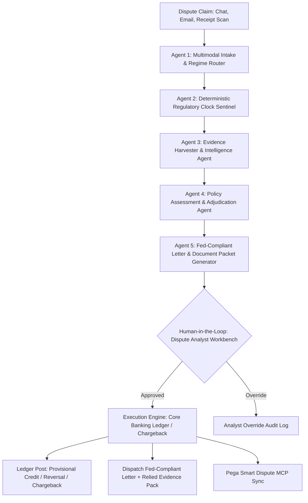

# RESOLV.AI // Card & Payment Dispute Investigation Agent

> **An Autonomous, Regulatory-Clock-Aware Investigation Pipeline Powered by Google Gemini & Deterministic Statutory Sentinel Engines.**  
> Built for Bank Operations & Chief Compliance Officers to eliminate Regulation E violations and automate dispute adjudication.

[](https://www.python.org/)
[](https://fastapi.tiangolo.com/)
[](https://ai.google.dev/)
[-green)](https://www.consumerfinance.gov/rules-policy/regulations/1005/)
[](https://www.pega.com/)

---

## 1. The Banking Crisis & Regulatory Pain

* **Exploding Volume:** In 2023, US consumers disputed **~105 million transactions worth $11 Billion**, with transaction volumes forecasted to surge over **+40% by 2026**.
* **Hard Statutory Deadlines (US Regulation E - 12 CFR § 1005.11):** A financial institution has **exactly 10 business days** to investigate a debit dispute or issue a provisional credit before extending to 45 (or 90) calendar days.
* **Federal Reserve 2026 Enforcement Actions:** Regulators are issuing major sanctions against card issuers for two systemic failures:
  1. **Generic denial notices:** Automated dispute systems outputting weak, unevidenced templates such as *"our records show no error occurred"*.
  2. **Withholding relied-upon documents:** Failing to furnish the specific forensic documents and telemetry the determination relied upon under **12 CFR § 1005.11(c)(2)(iv)**.
* **EU Payment Services Regulation (PSR 2026/2027):** Mandates immediate $D+1$ refunds for unauthorized transactions, establishes full statutory bank liability for authorized push payment (APP) impersonation fraud, and caps fraud suspicion holds at 15 business days.

---

## 2. High-Level Agent Architecture

RESOLV.AI coordinates a **Deterministic Sequential Agent Pipeline** separating non-probabilistic compliance math from cognitive LLM reasoning:



### The 5 Specialized Agents

| Stage | Agent Name | Engine | Responsibility |
| :--- | :--- | :--- | :--- |
| **01** | **Intake Agent** | Google Gemini (Multimodal) | Reads messy text, chat transcripts, and receipts; extracts transaction IDs and maps to `REG_E_DEBIT`, `REG_Z_CREDIT`, or `EU_PSR_PSD2`. |
| **02** | **Clock Sentinel** | **Deterministic Algorithm** | **Zero hallucination.** Calculates exact banking business days skipping Federal Reserve bank holidays and weekends; enforces statutory SLAs. |
| **03** | **Evidence Harvester** | Tool-Calling Agent | Queries core banking auth, 3DS 2.2 FIDO biometrics, IP geolocation, carrier tracking scans, and past dispute profiles. |
| **04** | **Assessment Agent** | Google Gemini (Compliance Reasoner) | Evaluates facts against statutory liability rules (e.g., 12 CFR § 1005.2(m)); derives legal findings and assigns burdens of proof. |
| **05** | **Letter Agent** | Google Gemini (Legal Drafter) | **Directly solves the Fed's 2026 violation.** Strictly eliminates boilerplate *"no error"* notices; authors bespoke letters citing exact telemetry with mandatory relied-upon document disclosures. |
| **HITL** | **Analyst Gate** | Operational Governance | Requires dispute analyst verification before simulated ledger dispatch. |

---

## 3. Statutory Clock & Regulatory Matrix

| Regime | Governing Statute | Provisional Credit Rule | Final Resolution SLA | Prohibited Practices |
| :--- | :--- | :--- | :--- | :--- |
| **US Reg E** | 12 CFR § 1005.11 | **10 Business Days** (mandatory credit to extend) | **45 Calendar Days** (90 for POS/Foreign/New Accts) | Generic "no error" templates; withholding relied-upon evidence dossiers. |
| **US Reg Z** | 12 CFR § 1026.13 | Disputed amount + finance charges withheld from collection | **30 Days Ack / 2 Billing Cycles (Max 90 Days)** | Adverse credit reporting or collection efforts while under investigation. |
| **EU PSR** | Art. 73 / Recital 58 | **D+1 (End of Next Business Day)** Immediate Refund | **15 Business Days** maximum hold only with documented fraud suspicion | Holding victims of telecom spoofing / bank impersonation scams liable. |

---

## 4. Pre-Configured Demonstration Scenarios

1. **#01 US Reg E: Unauthorized ATM Skim ($420.00)**
   * *Telemetry:* Magnetic stripe fallback read at Miami Beach ATM while customer was concurrently active on mobile banking from Seattle, WA (**2,730 miles in 60 seconds $\rightarrow$ Impossible Travel**).
   * *Adjudication:* `GRANT_PROVISIONAL_CREDIT` within 10 business days.
2. **#02 US Reg E: Defensible Friendly Fraud Denial ($1,250.00)**
   * *Telemetry:* Disputed PlayStation Network digital purchase verified via **3DS 2.2 FIDO FaceID** from customer's registered iPhone 15 Pro on home AT&T Fiber WiFi, with 18.5 hours of active gameplay on the registered console.
   * *Adjudication:* `DENY_CLAIM`.
   * *Fed Compliance:* Eliminates boilerplate; letter specifies the exact FaceID biometrics, residential IP, and console serial number with a formal inspection rights disclosure under 12 CFR § 1005.11(c)(2)(iv).
3. **#03 US Reg Z: Merchant Billing Error / Damaged Return ($899.00)**
   * *Telemetry:* Nordstrom luxury coat purchase with credit card. FedEx tracking confirms merchandise damaged in transit and returned to seller; merchant failed to credit customer.
   * *Adjudication:* `CHARGEBACK_INITIATED` under Payment Network Reason Code 4855; collection withheld under Reg Z rules.
4. **#04 EU PSR: Bank Impersonation / Social Engineering Scam (€3,500.00)**
   * *Telemetry:* Telecom Calling Line Identification (CLI) spoofing confirmed from fake bank fraud department; funds transferred to flagged neo-bank mule account.
   * *Adjudication:* `APPROVE_IMMEDIATE_REFUND` under the EU PSR bank impersonation fraud full indemnity mandate.

---

## 5. Quickstart & Installation

### Prerequisites
* Python 3.11+
* Google Gemini API Key ([Get an API key here](https://aistudio.google.com/))

### Setup Instructions

1. **Clone the repository:**
   ```bash
   git clone https://github.com/<your-username>/resolv-ai-dispute-agent.git
   cd resolv-ai-dispute-agent
   ```

2. **Install dependencies:**
   ```bash
   pip install -r requirements.txt
   ```

3. **Configure environment variables:**
   ```bash
   # Copy the template and add your Gemini API key
   cp .env.example .env
   ```
   Edit `.env`:
   ```bash
   GEMINI_API_KEY=your_actual_gemini_api_key_here
   ```

4. **Launch the application:**
   ```bash
   python run.py
   ```

5. **Open the Analyst Workbench:**
   Navigate to **`http://127.0.0.1:8000`** in your browser.

---

## 6. Pega Smart Dispute MCP Bridge

RESOLV.AI is designed to integrate into existing Tier-1 bank case management architectures through the **Model Context Protocol (MCP)**:

```
Pega Smart Dispute  <--->  [POST /api/pega/mcp/invoke]  <--->  RESOLV.AI Agents
```

### Supported MCP Tools:
* `compute_statutory_clock`: Invokes non-probabilistic regulatory calendar math.
* `harvest_evidence_dossier`: Pulls device telemetry, 3DS logs, and carrier tracking into the Pega case.
* `evaluate_dispute_case`: Emits policy assessment and drafts Fed-compliant determination notices.

---

## 7. Project Structure

```
├── .env.example               # Safe environment template
├── .gitignore                  # Git ignore rules (protects .env and secrets)
├── README.md                   # System documentation & architectural blueprint
├── requirements.txt            # Python dependencies
├── run.py                      # Application entrypoint launcher
├── start.bat                   # Windows one-click startup script
│
├── backend/
│   ├── agents/
│   │   ├── intake_agent.py     # Agent 1: Multimodal claim parser & regime router
│   │   ├── clock_agent.py      # Agent 2: Regulatory clock sentinel
│   │   ├── evidence_agent.py   # Agent 3: Evidence harvester & telemetry aggregator
│   │   ├── assessment_agent.py # Agent 4: Policy adjudicator & statutory test reasoner
│   │   ├── letter_agent.py     # Agent 5: Fed-compliant determination letter generator
│   │   └── pipeline.py         # Sequential pipeline orchestrator & HITL execution
│   │
│   ├── api/
│   │   └── app.py              # FastAPI REST API & Pega MCP Protocol Bridge
│   │
│   ├── engine/
│   │   ├── gemini_client.py    # Google GenAI SDK wrapper (Gemini 3.5/3.8 Flash)
│   │   └── regulatory_clock.py # Non-hallucinating calendar calculation engine
│   │
│   ├── models/
│   │   └── dispute.py          # Pydantic v2 domain schemas (Clocks, Dossiers, Cases)
│   │
│   └── tools/
│       ├── enterprise_data.py  # Mock Core Banking, 3DS, & Merchant databases
│       └── evidence_tools.py   # Standardized tool connectors for EvidenceAgent
│
├── frontend/
│   ├── index.html              # Dispute Operations Workbench UI
│   ├── style.css               # Fintech dark-mode glassmorphism design system
│   └── app.js                  # Frontend controller & live ticking countdown engine
│
└── tests/
    ├── test_regulatory_clock.py    # Statutory calendar & Fed holiday tests
    ├── test_evidence_tools.py      # Enterprise evidence harvester tests
    ├── test_sequential_pipeline.py # E2E tests for Scenarios #01 - #04
    └── test_api_and_mcp.py         # FastAPI & Pega MCP protocol tests
```

---

## 8. Running Automated Tests

Run the full verification suite in your terminal:

```bash
# 1. Test statutory clock math and holiday skips
python tests/test_regulatory_clock.py

# 2. Test evidence harvesting tools
python tests/test_evidence_tools.py

# 3. Test 5-stage sequential agent pipeline across all 4 scenarios
python tests/test_sequential_pipeline.py

# 4. Test REST API and Pega MCP endpoints
python tests/test_api_and_mcp.py
```

---

## License
MIT License. Built for Financial Operations, Fraud Risk, and Regulatory Compliance Teams.
